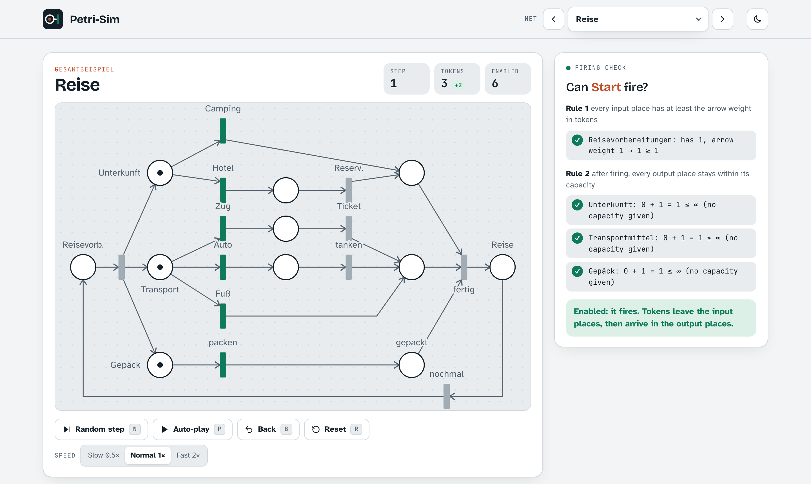

# Petri-Sim

An interactive Petri net simulator in the browser. Pick a net, click a transition to fire it, and watch the tokens travel along the arcs. Every click shows the firing rule worked out with the real numbers, so you can see *why* a transition can or can't fire.

**Live:** https://alielkassem0.github.io/petri-sim/



I built it while studying Petri nets for *Parallele und Funktionale Programmierung* at FAU Erlangen-Nürnberg. Firing nets on paper is slow and it's easy to get the capacity rule wrong, so I wanted something that checks every step for me.

## Features

- **11 example nets** grouped by type: the firing rule, capacity and self-loops; modelling elements (sequence, synchronisation, alternative, loops, a counting loop, confusion); and a full trip-planning example.
- **Step-by-step firing check.** Clicking a transition lists every input and output place with its numbers, e.g. `e₂: has 5, arrow weight 2 → 5 ≥ 2` or `s: 2 − 1 + 1 = 2 ≤ K = 2`.
- **Animated tokens.** Tokens leave the input places, travel into the transition, then on to the output places.
- **Next-step analysis.** After every step the app classifies the state as *stuck*, *forced* or *free choice* and points out conflicts (`Camping vs Hotel (both need the token in Unterkunft)`).
- **Controls:** random step, auto-play, undo, reset and three speeds. In some nets you can click a place to change its tokens.
- Light and dark theme, works on phones, keyboard shortcuts (`N` step, `P` play, `B` back, `R` reset, `[` `]` switch net), and respects reduced-motion settings.

## The rules it follows

A transition *t* can fire when:

1. every input place *p* has at least `W(p, t)` tokens, and
2. every output place stays within its capacity **after** firing: `M(p) − W(p, t) + W(t, p) ≤ K(p)`.

Firing sets `M'(p) = M(p) − W(p, t) + W(t, p)` for every place. Checking capacity *after* firing matters for self-loops: a place with 2 tokens and K = 2 can still feed a transition that puts the token straight back.

## Running it locally

```bash
npm install
npm run dev      # http://localhost:5173
npm test         # engine tests (Vitest)
npm run build    # type check + production build
```

## How it's built

Plain **TypeScript** and **Vite**, no UI framework. The net is drawn as SVG with DOM calls.

| File | What it does |
|---|---|
| `src/net.ts` | Types and the firing rule (`canFire`, `fire`, `explain`). Pure logic, no DOM. |
| `src/analysis.ts` | Enabled transitions, stuck / forced / free choice, conflict detection |
| `src/presets.ts` | All example nets as data |
| `src/render.ts` | Builds the SVG: arcs from edge to edge, arrowheads, weights, labels |
| `src/animate.ts` | Moves token dots along arcs; each move is a Promise |
| `src/main.ts` | UI state: marking, undo history, firing sequence, controls |
| `tests/net.test.ts` | Unit tests for the rules, including the capacity and self-loop cases |

Every push to `main` runs the tests and deploys to GitHub Pages with GitHub Actions.

## License

[MIT](LICENSE)
